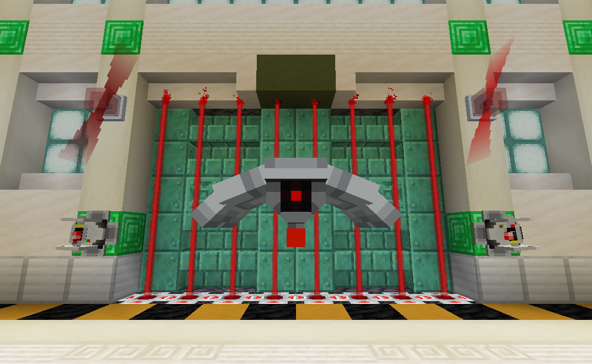

# Lockdown

This repository contains the source for the Lockdown datapack

# Test Coverage

A list of all mechanics that should be tested using the [GameTest](https://minecraft.wiki/w/GameTest) system:

|                   Test Name                    | Implemented? |
| ---------------------------------------------- | ------------ |
| Wireless transmitter/receiver                  |      ✅      |
| Block placement                                |      ⚠️      |
| Block placement when obstructed                |      ✅      |
| Block breaking                                 |      ✅      |
| Loot table consistency                         |      ✅      |
| Legacy block upgrading                         |      ❌      |
| Encoding (assign code)                         |      ✅      |
| Encoding (assign channel)                      |      ✅      |
| Force field projector                          |      ✅      |
| Laser projector range                          |      ✅      |
| Laser projector damage                         |      ✅      |
| Keycards & keycard readers                     |      ❓      |
| Keycards & drones                              |      ❓      |
| Keycards & turrets                             |      ❓      |
| Klaxon                                         |      ✅      |
| Wireless alarm lights                          |      ✅      |
| Player detector (ignore mobs, detect players)  |      ✅      |
| Mob detector (ignore technical entities)       |      ✅      |
| Big buttons (clickable, wireless transmission) |      ✅      |
| Range upgrades on drones                       |      ❌      |
| Range upgrades on turrets                      |      ❌      |
| Durability upgrades on drones                  |      ✅      |
| Durability upgrades on turrets                 |      ✅      |
| Flamethrower upgrades on drones                |      ✅      |
| Flamethrower upgrades on turrets               |      ✅      |
| Applying drone/turret upgrades                 |      ❓      |
| Drone targeting and firing                     |      ✅      |
| Drone targeting and firing w/ codes            |      ✅      |
| Turret targeting and firing                    |      ✅      |
| Turret targeting and firing w/ codes           |      ✅      |
| Chest key                                      |      ❓      |
| Encoder dispensing prevention                  |      ✅      |
| Berserker drones                               |      ✅      |
| Spray paint                                    |      ❌      |
| Laser blaster                                  |      ❓      |
| Air defense cannon                             |      ✅      |

> **Note**: Tests marked with "❓" involve a feature that *requires* player interaction.  As such, I'm not yet sure how to implement automated tests for them.

Items not covered under the GameTest system:
|                   Test Name                    | Implemented? |
| ---------------------------------------------- | ------------ |
| Static code analysis                           |      ❌      |
| Data pack load errors                          |      ❌      |
| Resource pack load errors                      |      ❌      |
| Advancements                                   |      ❌      |
| Translation key existence checks               |      ✅      |
| JSON text resolution errors                    |      ❓      |

# Known Bugs

* Drones don't target players properly after entering berserker mode

# Near-Term TODO:

* ~~Berserker drone unit tests~~:
    * ~~Does not attack hostile mobs~~
    * ~~Attacks friendly mobs~~
    * ~~Does not attack other drones with same channel~~
    * ~~Attacks other drones with different channel~~
* Air defense cannon
    * ~~Charging animation~~
    * ~~Firing animation~~
    * ~~Explosion when destroyed~~
    * ~~Placement~~
    * ~~Movement controls~~
    * ~~Spray-painting~~
    * ~~Firing controls~~
    * Add toggle for terrain destruction
    * Tweak model so it doesn't block line of sight
    * Tweak sound effects
    * ~~Fix berserker drones targeting cannons~~
    * Balancing
        * Require redstone energy cells to fire?
* ~~Air defense cannon unit tests~~:
    * ~~Platform obstructed if block or entity within 3x3 space~~
    * ~~Breaks if central block is missing~~
    * ~~Drops platform, gantry, and barrel~~
    * ~~Mounting gantry onto platform~~
    * ~~Mounting barrel onto gantry~~
    * ~~Explodes if hidden bee is killed~~
* ~~Make turrets dyable~~
* ~~Make the "drone attacks X" game tests more reliable~~
* ~~Tweak cannon advancements~~
* Make suspicious thumb drive obtainable
* ~~Test in 26.3~~

* Make turrets remember approved entities similar to drones?

# Version Support

This datapack uses overlays to support versions 1.21.5-26.2.

## Older Versions

Old 1.16, 1.17, and 1.20.1 versions are available on the project's GitHub page [here](https://github.com/RedstoneTesseracted/Lockdown/releases)

# Credits

This datapack makes use of the following sound effects:

|                           Name                             |    Author      |              Link               |                                License                                   |
| ---------------------------------------------------------- | -------------- | ------------------------------- | ------------------------------------------------------------------------ |
| alarm3.WAV                                                 | phantastonia   | https://freesound.org/s/270640/ | [Creative Commons 0](https://creativecommons.org/publicdomain/zero/1.0/) |
| Permission Denied.wav                                      | ironcross32    | https://freesound.org/s/582632/ | [Creative Commons 0](https://creativecommons.org/publicdomain/zero/1.0/) |
| Beep Bad                                                   | unfa           | https://freesound.org/s/154888/ | [Creative Commons 0](https://creativecommons.org/publicdomain/zero/1.0/) |
| blaster shot 8_1(Sytrus,rsmpl,multiprcsng)single.wav       | newlocknew     | https://freesound.org/s/514058/ | [Attribution 4.0](https://creativecommons.org/licenses/by/4.0/)          |
| blaster shot 11_2(Sytrus,rsmpl,3lrs,multiprcsng)single.wav | newlocknew     | https://freesound.org/s/514050/ | [Attribution 4.0](https://creativecommons.org/licenses/by/4.0/)          |
| Sci-fi rifle weapon shot_3 (14lrs,mltprcssng).wav          | newlocknew     | https://freesound.org/s/557513/ | [Attribution 4.0](https://creativecommons.org/licenses/by/4.0/)          |
| Sci-fi rifle weapon shot_2-1 (17lrs,mltprcssng).wav        | newlocknew     | https://freesound.org/s/557514/ | [Attribution 4.0](https://creativecommons.org/licenses/by/4.0/)          |
| allpass glitch 26                                          | deadrobotmusic | https://freesound.org/s/662725/ | [Creative Commons 0](https://creativecommons.org/publicdomain/zero/1.0/) |
| Click (1).mp3                                              | 7778           | https://freesound.org/s/202314/ | [Creative Commons 0](https://creativecommons.org/publicdomain/zero/1.0/) |
| error-sound                                                | WilliamRBX     | https://freesound.org/s/686727/ | [Creative Commons 0](https://creativecommons.org/publicdomain/zero/1.0/) |
| spraycan2.wav                                              | HerbertBoland  | https://freesound.org/s/28543/  | [Attribution 4.0](https://creativecommons.org/licenses/by/4.0/)          |
| spraycan3.wav                                              | HerbertBoland  | https://freesound.org/s/28544/  | [Attribution 4.0](https://creativecommons.org/licenses/by/4.0/)          |
| Spray Paint Shake Seven.wav                                | cbakos         | https://freesound.org/s/200377/ | [Creative Commons 0](https://creativecommons.org/publicdomain/zero/1.0/) |
| Sci-fi rifle weapon shot. With charging sweep_3 (23lrs,mltprcssng).wav | newlocknew | https://freesound.org/s/557515/ | [Attribution 4.0](https://creativecommons.org/licenses/by/4.0/)          |
